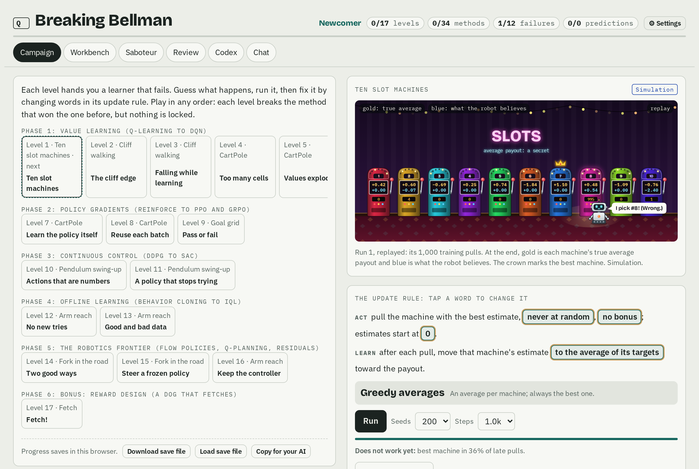
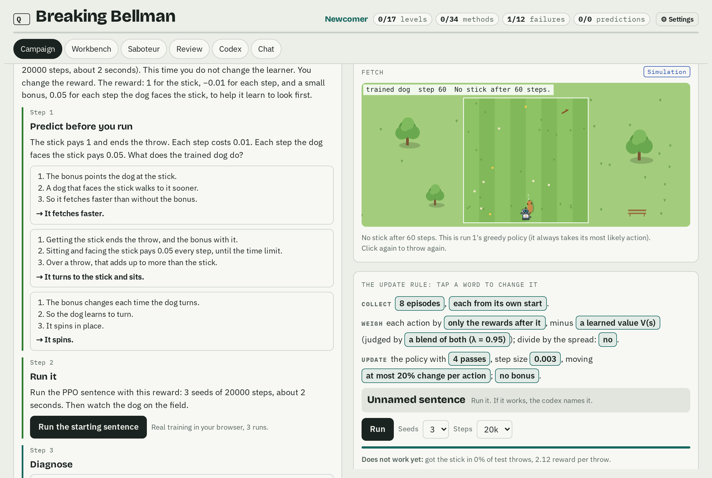
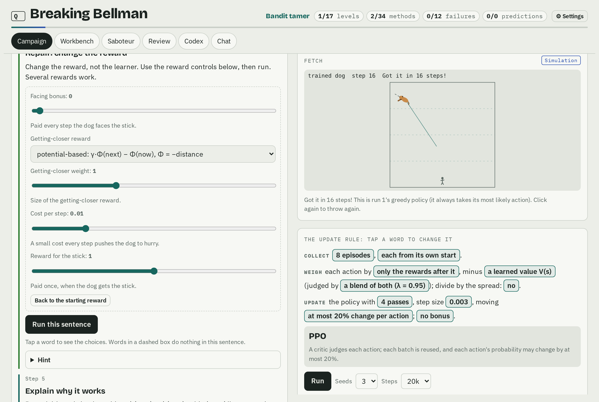
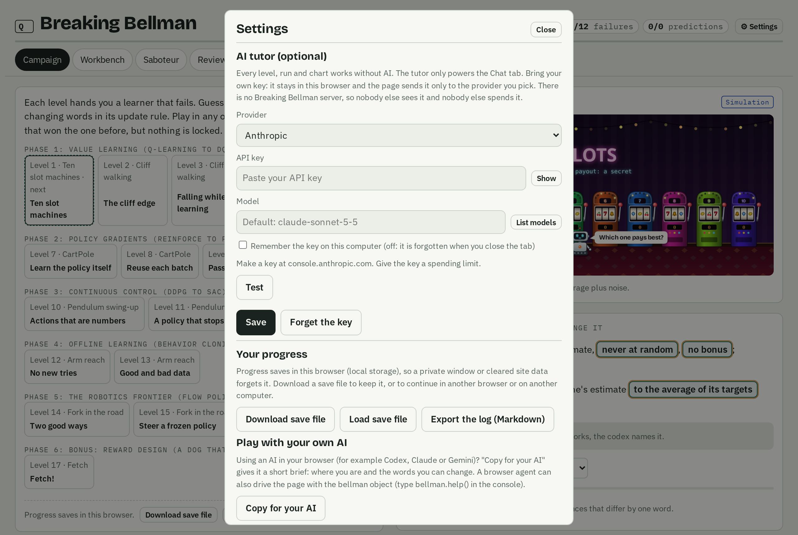
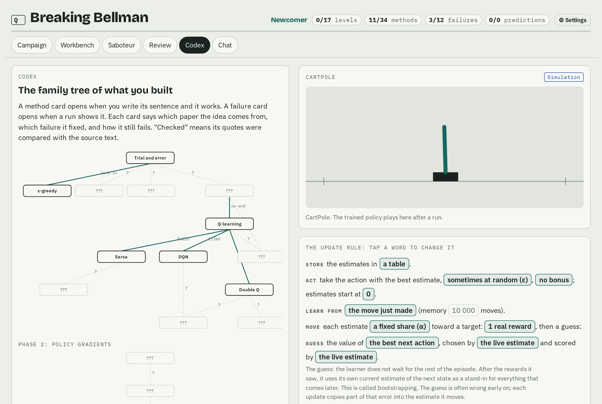
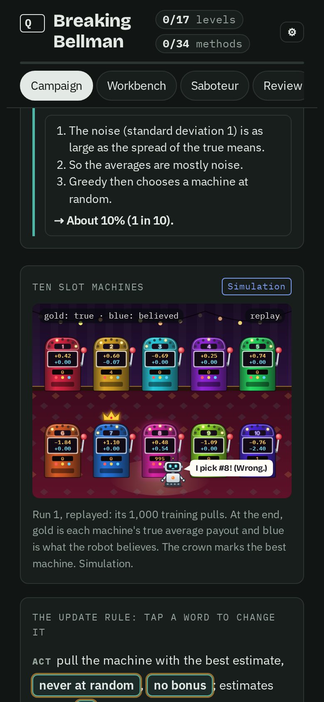

# Breaking Bellman

**Learn reinforcement learning by breaking it.** Real reinforcement learning (RL) algorithms train in your browser, in seconds, and fail in front of you. You find out why they fail, you fix them, and the fix turns out to be a published method: Q-learning, DQN, PPO, GRPO, SAC, IQL, and the robot-learning methods of today.

It is one HTML file. There is no server, no account and no install. An AI tutor is optional, and it uses your own key.



## Why I made this

I made this game to learn RL myself. I learn best when I build things and when I watch them break. Reading a derivation of the Bellman equation never told me which parts matter. Watching a value estimate climb to 4.7 million on CartPole, where no policy can earn more than 100, did.

So Breaking Bellman is a sandbox that puts you in situations where an algorithm breaks. Each level hands you a learner that fails: it locks onto the wrong slot machine, it walks off a cliff while it explores, its values explode, it chases a mirage, it forgets what it learned. You predict what will happen, you run it, you read the autopsy, and you change one word of its update rule. When your sentence works, the game tells you which paper you just rediscovered. You rebuild RL from scratch, one failure at a time, and the failures show you what is important.

I also built this with AI. An AI assistant wrote most of the code, read the papers with me, and ran the hundreds of experiments behind every number in the game. That is the other thing I wanted to test: AI that helps you make your own learning tools speeds up learning. You can do the same: fork it, add a world, and break something new.

I am a software engineer who is learning robotics with a small robot arm (an SO-101). The last phases of the game come from that: offline data, action chunks, a frozen policy steered by a critic, and a learned correction on top of a classical controller.

I wrote about what breaking these algorithms taught me in a blog post: [I learn by breaking things, so I made a game where RL breaks](https://hadrien-cornier.github.io/robotics/breaking-bellman/).

## Play

**Option 1: download one file.** [Download `breaking-bellman.html`](https://github.com/Hadrien-Cornier/breaking-bellman/releases/latest/download/breaking-bellman.html) (from the [latest release](https://github.com/Hadrien-Cornier/breaking-bellman/releases/latest)) and open it in Chrome, Edge, Firefox or Safari. It works offline.

**Option 2: run it from the source.** You need [Node.js](https://nodejs.org) 18 or newer. There are no dependencies to install.

```bash
git clone https://github.com/Hadrien-Cornier/breaking-bellman.git
cd breaking-bellman
npm start
```

Then open http://localhost:8642. `npm start` builds `dist/breaking-bellman.html` and serves it on your computer only.

Your progress stays in your browser (local storage). To keep a record, use **Settings, Export the log**: it writes a Markdown file with every method and failure you found, your sentence and your result.

## How a level works

Each level gives you a world, a learner that fails, and six steps:

1. **Predict.** Pick what you think will happen. Each answer is a short chain of reasoning, and the feedback says at which step a wrong chain breaks.
2. **Run.** Real training, in a Web Worker in your browser. Every curve comes from code that just ran. The page labels every result "Simulation".
3. **Diagnose.** Read the charts and the autopsy (a list of symptoms with numbers), and watch one update of the learner, number by number.
4. **Repair.** The update rule is a sentence of plain words, for example "move the estimate toward *the payout plus the best next estimate*". Tap a word to change it. Run again.
5. **Explain.** Say why your repair works.
6. **Compare.** The codex shows the published method that matches your sentence, word by word, with its paper, what it fixed, and how it still fails.

When a run does something surprising, a **Did you notice?** card asks you to look at one chart and say what you see before it explains.

<table><tr>
<td></td>
<td></td>
</tr><tr>
<td>The "Fetch!" bonus level. A small bonus for facing the stick looked helpful. PPO learned to sit and face it: no stick after 60 steps.</td>
<td>The repair changes the reward, not the learner. With potential-based shaping, the same PPO sentence fetches the stick in 16 steps.</td>
</tr></table>

The other tabs:

| Tab | What you do |
|---|---|
| Campaign | 17 levels, from slot machines to robot learning. Each level breaks the method that won the level before. |
| Workbench | Any sentence on any world. Pin a run as A and compare it with a sentence that differs by one word. |
| Saboteur | Missions: turn the knobs of a world (sensor noise, command latency, sparse reward: each a real property of real robots) until the run shows what the mission asks. |
| Review | Rebuild the methods you found from memory, mixed across worlds. |
| Codex | The family tree of what you found, with the sources. |
| Chat | Optional AI tutor that can read the lab, change words and start runs (bring your own key). |

## The campaign

| # | Level | World | What breaks | What you rediscover |
|---|---|---|---|---|
| 1 | Ten slot machines | Bandit | Greedy choice locks onto a worse machine | ε-greedy, optimistic starts, UCB |
| 2 | The cliff edge | Cliff walking | Waiting for the end of the episode learns slowly | Temporal difference (Q-learning), n-step |
| 3 | Falling while learning | Cliff walking | Q-learning falls off while it explores | Sarsa, Expected Sarsa |
| 4 | Too many cells | CartPole | A table cannot hold a continuous state | A neural network, and the deadly triad |
| 5 | Values explode | CartPole | Bootstrapping, a network and old data feed each other | DQN (target network, replay) |
| 6 | The mirage | Two doors | The max of noisy estimates sees a mirage | Double Q-learning |
| 7 | Learn the policy itself | CartPole | Whole-episode credit is noise | REINFORCE, baselines |
| 8 | Reuse each batch | CartPole | Many passes on one batch wreck the policy | PPO |
| 9 | Pass or fail | Goal grid | A critic that cannot see the clock | GRPO, Monte Carlo returns |
| 10 | Actions that are numbers | Pendulum | A critic that the policy climbs overestimates | DDPG, TD3 |
| 11 | A policy that stops trying | Pendulum | The policy stops exploring | SAC |
| 12 | No new tries | Arm reach | Offline, the critic trusts actions it never saw | TD3+BC, IQL |
| 13 | Good and bad data | Arm reach | Copying everything copies the failures | Filtered copying, AWR, IQL |
| 14 | Two good ways | Fork in the road | The average of two good paths hits the obstacle | Flow-matching policies, action chunks (π0, ACT) |
| 15 | Steer a frozen policy | Fork in the road | A frozen copier walks through the mud | Best-of-N, Q-planning, EXPO |
| 16 | Keep the controller | Arm reach | Learning from scratch is far worse than a classical controller | Residual RL |
| 17 | Fetch! (bonus) | Fetch | A helpful reward bonus becomes the goal | Reward hacking, potential-based shaping |

The bonus level is inspired by [Huggy](https://huggingface.co/learn/deep-rl-course/unitbonus1/introduction), the dog of the Hugging Face Deep RL course. Here the dog only turns and walks, so the lesson is the reward. After training, click the field to throw the stick, and watch your dog fetch it (or sit and stare at it).

## The AI tutor: bring your own key

The game does not need AI. Every level, run and chart works without it. The tutor only powers the Chat tab: it reads the lab, changes words, starts runs, and asks you to predict before it explains.

Open **Settings** and pick a provider:

| Provider | What you need |
|---|---|
| Anthropic | An API key from console.anthropic.com |
| OpenAI | An API key from platform.openai.com |
| OpenRouter | An API key from openrouter.ai (many models) |
| Ollama | Ollama on your computer: no key and no cost per message. Start it with `OLLAMA_ORIGINS=* ollama serve` so the page may call it. |
| Other | Any server with an OpenAI-compatible `/chat/completions` endpoint |

**Where your key goes.** The page sends your key only to the provider you pick, straight from your browser. There is no Breaking Bellman server in between, so nobody else sees your key and nobody else spends it. By default the key lives in session storage and is gone when you close the tab. You can choose "Remember the key on this computer" (local storage). "Forget the key" deletes it.

**Why there is no hosted version with a tutor.** A hosted tutor needs a server that holds a key, and then every visitor spends the owner's money. With bring-your-own-key, the same HTML file is safe to host anywhere (for example on GitHub Pages): each visitor pays only for their own messages, or nothing with Ollama.



The usual cautions apply to any key you paste into a web page: use a key with a spending limit, and do not paste it into a copy of the page that you do not trust. This file loads nothing from the network except the requests to your provider.

## Is it accurate?

Every number in the text of the game was measured with the game's own engine and logged in [`EXPERIMENTS.md`](EXPERIMENTS.md): the question, the prediction, the settings, the results and the limits, including the runs that failed. The configs and raw outputs are in [`exp/`](exp/).

Every codex card says where its idea comes from and carries a status: **Checked against the source** (a person or an agent read the paper and the claim was checked), or **Not checked**. Each card links to the paper. Every arXiv id was checked against arXiv.

The worlds are toys, and each level says what its world cannot teach. CartPole is not a robot, and a 2D dog is not Huggy. The goal is to see the mechanism of each failure clearly, in seconds, on a laptop.

<table><tr>
<td width="62%"></td>
<td></td>
</tr><tr>
<td>The codex grows a family tree as you find methods. Each card links to its paper.</td>
<td>It works on a phone, in light or dark mode.</td>
</tr></table>

## How it works

| Part | Files |
|---|---|
| Engine: plain JavaScript, no dependencies, typed arrays, runs in Node and in Web Workers | `src/core` (random numbers, a small MLP with Adam), `src/worlds` (9 worlds), `src/agents` (value learning, policy gradients, actor-critic and offline), `src/sim` (training runs and the autopsy) |
| Content: levels, cards, questions, measured numbers | `web/content*.js`, `web/measured.js`, `web/expert.js`, `web/wonder.js`, `web/fetch-level.js`, `web/papers.js` |
| Page | `web/page.html`, `web/style.css`, `web/app.js`, `web/llm.js` (the bring-your-own-key client) |
| Build | `build.mjs` inlines everything, fonts included, into `dist/breaking-bellman.html` |

The engine interfaces are in [`ENGINE.md`](ENGINE.md). To add a world, write one file in `src/worlds/` with `reset`, `step` and `render`, add it to `build.mjs`, and give it a name in the content.

```bash
npm test            # unit tests of the engine, the worlds and the AI client (Node only)
npm run smoke       # end-to-end browser test (needs Playwright: npm i -D playwright && npx playwright install chromium)
node test/ui/shots.mjs docs/screenshots   # the screenshots in this README
```

## Optional: Notion

If you open the page as a claude.ai artifact with the Notion connector, it can save a snapshot of each discovery to a Notion database. It is off unless you build with a `local.config.json` (not in git):

```json
{ "notion": { "ds": "<data source id>", "db": "<database URL>", "page": "<the page URL>", "dbName": "My discoveries" } }
```

## Credits

- Richard S. Sutton and Andrew G. Barto, [*Reinforcement Learning: An Introduction*](http://incompleteideas.net/book/the-book-2nd.html), 2nd edition (2018). Most of phase 1 follows its examples: the 10-armed testbed, cliff walking, the maximization-bias example.
- The papers on each codex card, linked from the card.
- [Huggy](https://huggingface.co/learn/deep-rl-course/unitbonus1/introduction) from the Hugging Face Deep RL course, for the idea of the fetch level.
- Fonts: IBM Plex Sans, IBM Plex Mono and Bricolage Grotesque (SIL Open Font License).
- [MathJax](https://www.mathjax.org) 3.2.2 (Apache License 2.0) draws the equations. The file includes it, so equations work offline.

## License

MIT. See [LICENSE](LICENSE).

## Limits

- The worlds are small on purpose. A method that works here can still fail on a real robot, and the reverse.
- On the network worlds, a run in the page uses 1 to 5 seeds, and the experiment log mostly 3 to 5 (the table worlds use 200 to 300 runs). Small differences between sentences are not significant.
- The AI tutor is as good as the model you connect. It can be wrong. The game tells it to state only facts from cards marked "Checked".
- Progress lives in one browser. Clearing site data erases it, so export it first.
