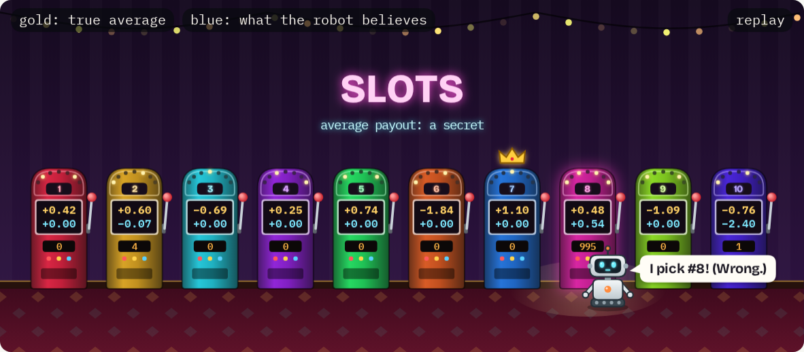
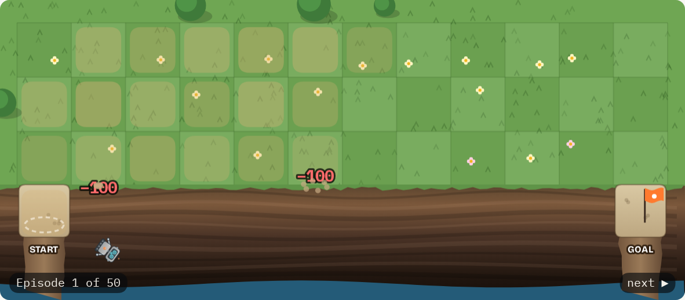
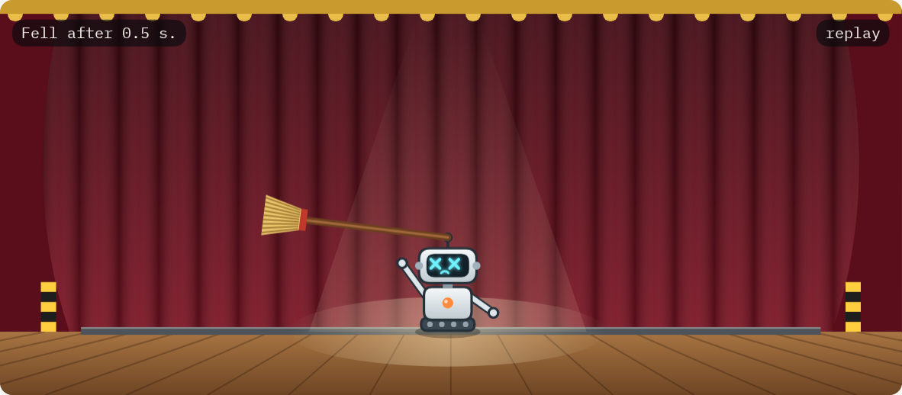

# Breaking Bellman

A small browser game for learning reinforcement learning. You watch RL algorithms fail, work out why, and fix them by changing one word of their update rule. Then the game tells you which paper you just reinvented.

**[Play it in your browser](https://hadrien-cornier.github.io/breaking-bellman/)** · [Download the HTML file](https://github.com/Hadrien-Cornier/breaking-bellman/releases/latest/download/breaking-bellman.html) · [Blog post](https://hadrien-cornier.github.io/robotics/breaking-bellman/)



## What you do

There are 17 levels. Each one hands you a learner that is broken in an educational way. A few of them:

- A robot in a casino finds one decent slot machine and never looks at the others again.
- A robot explores a cliff edge by falling off it. A lot.
- A DQN's value estimate climbs to 4.7 million on a task where the best possible score is 100.
- A dog learns that staring at the stick pays better than fetching it.

You guess what will happen, press Run, and real training runs in your browser in a few seconds. Then you read the autopsy and change a word. For example, "move the estimate toward *the payout*" becomes "toward *the payout plus the best next estimate*". If that works, congratulations: you invented Q-learning (Watkins got there in 1989). Keep going and you end up at DQN, PPO, GRPO, SAC, IQL and a few robot-learning tricks.

| Cliff walking | CartPole |
|---|---|
|  |  |

I made this to learn RL myself, because I learn best by breaking things. An AI assistant wrote most of the code and ran the experiments with me.

## Play

- **Browser:** [hadrien-cornier.github.io/breaking-bellman](https://hadrien-cornier.github.io/breaking-bellman/). Phones work too.
- **Offline:** download [`breaking-bellman.html`](https://github.com/Hadrien-Cornier/breaking-bellman/releases/latest/download/breaking-bellman.html) and open it. It is one 3 MB file with nothing to install.
- **From source:** Node 18 or newer, zero dependencies.

  ```bash
  git clone https://github.com/Hadrien-Cornier/breaking-bellman.git
  cd breaking-bellman && npm start   # then open http://localhost:8642
  ```

Every level is open, so play them in any order. Your progress saves in your browser. To move it to another browser or computer, use **Download save file** and **Load save file** (under the level map, or in Settings).

## Bring your own AI (optional)

The game does not need AI. If you want help:

- **Chat tab:** paste your own key (Anthropic, OpenAI or OpenRouter), or use a model on your machine with Ollama. The key stays in your browser and goes straight to that provider. There is no Breaking Bellman server, so nobody else sees your key or spends it.
- **Your own assistant:** click **Copy for your AI** and paste the brief into whatever you use. It says which level you are on and which words you can change.
- **Browser agents:** the page has a `bellman` object, so an agent (or you, in the console) can drive it: `bellman.help()`, `bellman.level(3)`, `bellman.words({ eps: 'eps' })`, `await bellman.run()`.

## How it works

Plain JavaScript with no dependencies: small neural networks with Adam on typed arrays, nine toy worlds, three families of learners, and an "autopsy" that turns training curves into symptoms. `build.mjs` inlines everything into one HTML file. Each training run gets its own Web Worker.

| Folder | What is in it |
|---|---|
| `src/core` | Random numbers, a small MLP with Adam |
| `src/worlds` | The nine worlds |
| `src/agents` | Value learning, policy gradients, actor-critic (online and offline) |
| `src/sim` | Training runs and the autopsy |
| `web` | The page, the levels, and `scenes.js`, which draws the robot |

`npm test` runs the engine tests. `npm run smoke` plays the page in a headless browser. [`ENGINE.md`](ENGINE.md) describes the interfaces, so adding a world is one file.

**Does it use my GPU?** No, on purpose. The networks have two layers of 32 units, and each step waits for the one before it. Shipping that to a GPU and waiting for the answer costs more than the math itself. On a CPU a training step takes 0.1 to 3 milliseconds.

## Is it accurate?

The worlds are toys. CartPole is not a robot, and a 2D dog is not [Huggy](https://huggingface.co/learn/deep-rl-course/unitbonus1/introduction). Still, every number in the game's text was measured with this engine and logged in [`EXPERIMENTS.md`](EXPERIMENTS.md), failed runs included. Every method card links its paper and says whether its claim was checked against it.

## Credits

- Sutton and Barto, [*Reinforcement Learning: An Introduction*](http://incompleteideas.net/book/the-book-2nd.html) (2018). Phase 1 follows its examples.
- [Huggy](https://huggingface.co/learn/deep-rl-course/unitbonus1/introduction) from the Hugging Face Deep RL course, for the fetch level.
- IBM Plex and Bricolage Grotesque fonts (SIL Open Font License), [MathJax](https://www.mathjax.org) 3.2.2 (Apache 2.0).

MIT license. See [LICENSE](LICENSE).
