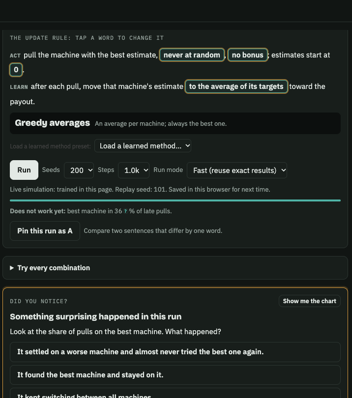

# Breaking Bellman

A browser game for learning reinforcement learning.

Each level hands you a learner that fails. You guess what it will do, run real training in the page, then change one word of its update rule. Get that word right and you have reinvented a published method. The game names the paper.

I made it to learn RL myself, because I learn best by breaking things. The failure is on the screen before the formula. There are 19 levels, in any order, from slot machines and Q-learning through DQN, PPO, SAC, and a few robot-learning tricks. Two later levels compare learners instead of asking you to repair one sentence. No account, and no server.

**[Play it in your browser](https://hadrien-cornier.github.io/breaking-bellman/)**



Level 1 on the [live site](https://hadrien-cornier.github.io/breaking-bellman/), 22 October 2026. The outlined words are the update rule. Greedy averages keep one machine and stop trying the rest.

## Play

- **Browser**, including a phone: [hadrien-cornier.github.io/breaking-bellman](https://hadrien-cornier.github.io/breaking-bellman/).
- **Offline:** download [`breaking-bellman.html`](https://github.com/Hadrien-Cornier/breaking-bellman/releases/latest/download/breaking-bellman.html) and open it. One file, nothing to install.
- **From source** (Node 18 or newer):

  ```bash
  git clone https://github.com/Hadrien-Cornier/breaking-bellman.git
  cd breaking-bellman && npm start
  ```

  Then open http://localhost:8642.

Progress saves in this browser. **Download save file** and **Load save file**, under the level map, move it to another browser or computer.

By default a run reuses a published result, then a result saved in this browser, then trains fresh. **Watch one update** always trains live. The storage details are in [`scripts/FAST.md`](scripts/FAST.md).

You can play with no AI assistant. Settings can hold your own key, and the key stays in the browser. **Copy page** turns what is on screen into Markdown for any chat.

The worlds are toys. Measurements, failed runs included, are in [`docs/EXPERIMENTS.md`](docs/EXPERIMENTS.md). [`docs/ENGINE.md`](docs/ENGINE.md) describes the pieces, so you can add a world. A [short post](https://hadrien-cornier.github.io/robotics/breaking-bellman/) walks through the idea.

## Credits

- Sutton and Barto, [*Reinforcement Learning: An Introduction*](http://incompleteideas.net/book/the-book-2nd.html) (2018).
- [Huggy](https://huggingface.co/learn/deep-rl-course/unitbonus1/introduction), from the Hugging Face Deep RL course, for the fetch level.
- IBM Plex and Bricolage Grotesque (SIL Open Font License), [MathJax](https://www.mathjax.org) 3.2.2 (Apache 2.0).

MIT license. See [LICENSE](LICENSE).
